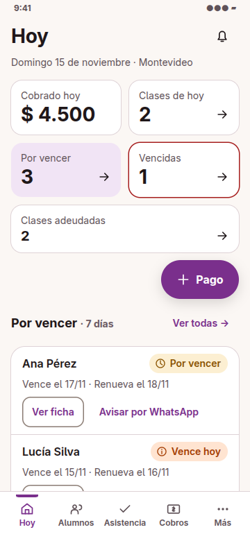
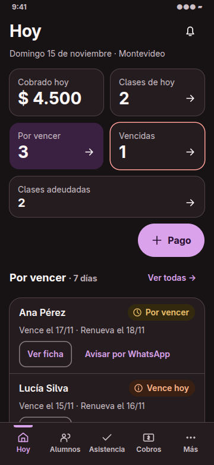
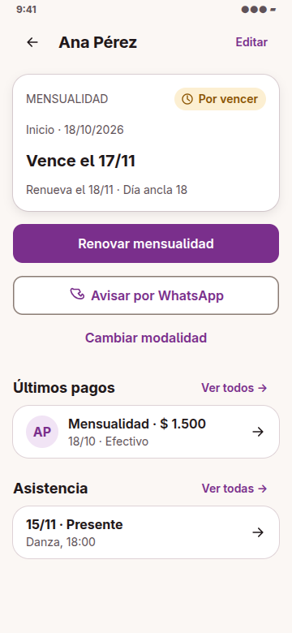
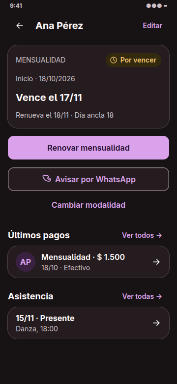
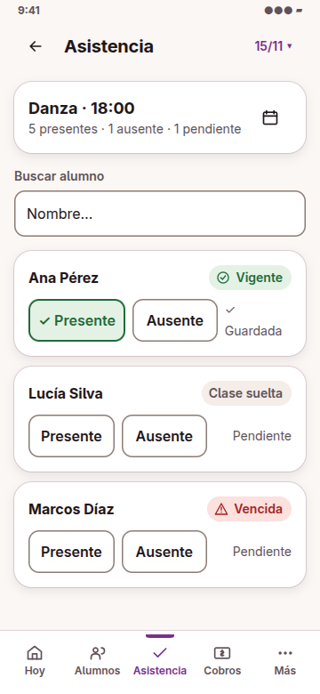
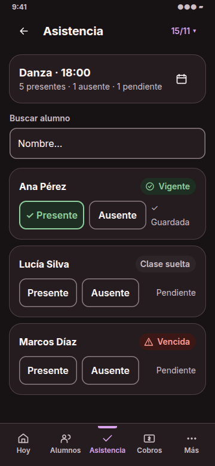
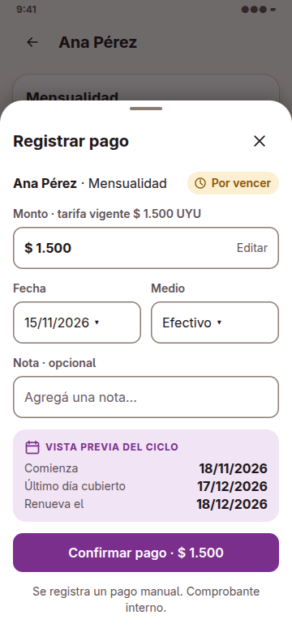
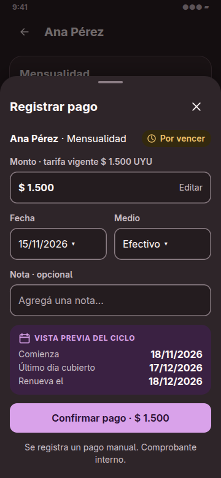

# Alta fidelidad estática · cuatro vistas clave

**Base UX:** Fina `docs/diseno/ux/02-wireframes.md` (W1 Hoy, W4 Asistencia, W7 Ficha, W8 Cobro). **Viewport de captura:** 360×780 CSS px, Chrome, 15/11/2026. **Datos sintéticos:** Ana Pérez, Lucía Silva, Marcos Díaz, Danza 18:00. Precios $ 1.500 / $ 4.500 solo de muestra de composición; **no son tarifa aprobada**. La UI no calcula ciclos. Las fechas son ejemplos de vistas devueltas por dominio según PLAN §3; no se codifican como lógica. Capturas de una maqueta temporal, estática, sin persistencia ni navegación funcional. Las láminas son PNG de 360×780.

| Vista | Claro | Oscuro | Decisión visual y acción siguiente |
|---|---|---|---|
| **Hoy** |  |  | Métricas en dos columnas, «Clases adeudadas» a ancho; lista «Por vencer» **visible**, con fechas `vence` y `renueva`; `+ Pago` ocupa reserva entre métricas y lista para no tapar `Avisar por WhatsApp`. Una clase de hoy baja por scroll. Los números abren filtros; las filas abren ficha; WhatsApp abre editor manual. W1. |
| **Ficha de alumno** |  |  | Estado + modalidad, inicio, último día cubierto, renovación y ancla; renovación es primaria. WhatsApp y cambio de modalidad en filas apiladas para 360 px. Secciones de pagos y asistencia. W7. |
| **Asistencia** |  |  | Encabezado con clase y cuenta, alumnos en tarjetas; dos botones `Presente/Ausente` por fila, estado de guardado separado. Lucía clase suelta; Marcos vencida: marcar presente **no bloquea** y abre sugerencia del wireframe W5/W6 tras guardado. «Cancelar clase» queda **más abajo en scroll**, no es acción flotante accidental. W4. |
| **Cobro de mensualidad** |  |  | Hoja inferior sobre ficha atenuada, monto, fecha, medio, nota y vista previa del ciclo; CTA incluye monto. No es cobro online. «Confirmar» solo se habilita con importe válido y respuesta de vista previa, y se bloquea en envío; **la lámina no ejecuta nada**. W8. |

## Comportamiento de las cuatro vistas fuera de la captura

- **Hoy:** sin alumnos → «Todavía no hay alumnos» + «Agregar alumno»; sin próximas renovaciones → «Nadie por vencer en este período»; sin clases → «No hay clases hoy» + «Ver horario». Si una sección falla, no reemplazarla por cero ni borrar el resto. Un toque en una métrica abre Cobros filtrado. Scroll al detalle sin que la acción flotante cubra controles; la zona reservada de la lámina es una decisión para **esta** pantalla y ancho, no un valor absoluto para la app.
- **Ficha:** `Pagada, sin iniciar` muestra pago y prevista *si el dominio la provee*, nunca un inicio definitivo inventado (Q1 de Fina); `Sin mensualidad` elimina fechas y presenta «Cobrar mensualidad»; `Clase suelta` muestra clases adeudadas sin chip de mensualidad. La acción WhatsApp sin teléfono lleva a agregarlo y no simula envío. Cambio de modalidad muestra impacto del dominio y confirmación (Fina W11).
- **Asistencia:** presente mensualidad vigente se guarda al confirmar servidor; por vencer/vence hoy mantiene fechas y no cobra automáticamente. Si clase suelta, al guardar abre W5 «Cobrar clase» / «Dejar adeudada»; si vencida o sin mensualidad, W6 ofrece cobrar mensualidad/clase suelta/seguir sin cobrar. Cancelada por instituto o ausente no cobran. Falla por fila muestra «No se guardó esta asistencia», no check falso.
- **Cobro:** hoja escroleable con teclado; cambio de monto requiere motivo; no hay vista previa local. Si no hay próxima clase, estado `Pagada, sin iniciar`/fecha pendiente según dominio y Q1. Cargando → skeleton + «Cargando…» y CTA inhabilitado; sin conexión → formulario conservado + «Necesitás internet para registrar pagos»; incertidumbre de resultado → «Estamos comprobando si se registró. No vuelvas a cargar el pago»; éxito **solo después del servidor** → W13 comprobante interno y actor nominal. Anular es W14, fuera del CTA de cobro y con motivo obligatorio.
- **Ambos temas:** los chips mantienen icono, texto y color semántico. El color de marca puede cambiar, pero no sustituye los colores de estado. La lámina a 360×780 **no** prueba teclado, foco de TalkBack/VoiceOver, 320 px o texto al 200 %; exigencias especificadas en [`componentes.md`](componentes.md), pendientes de app/prototipo interactivo y pruebas.

## A revisar con Fina/Ada

1. Resolver Q1–Q5 de Fina antes de fijar estados inciertos o impactos de modificación de cobros y asistencias.
2. Verificar si el instituto piloto tiene logo y acento para sustituir la marca provisional; contrastar ese color por tema.
3. Validación con dueña y otra operadora, prototipo navegable y pruebas de teclado/lector en dispositivo: **no realizadas**. La revisión aquí es estrictamente visual/algorítmica de tokens y captura en Chrome.
